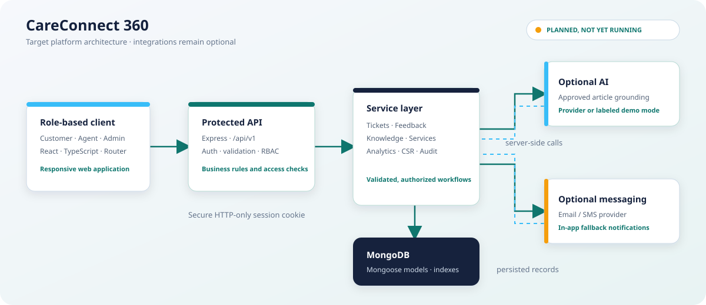
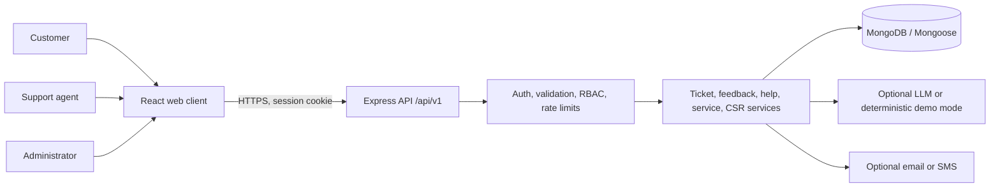

# CareConnect 360

> **Every Complaint Matters. Every Customer Deserves Care.**

CareConnect 360 is an AI-assisted customer-service and social-impact platform in development. It is designed to bring customer complaints, support workflows, consumer guidance, service requests, feedback, and evidence-backed community impact into one role-aware application.



> **Project status:** Frontend shell plus the first Stage 3 slice. The Vite/React client and Express/MongoDB authentication API run locally. Registration, login, logout, session lookup, and development password reset are implemented and tested. Role dashboards, ticket workflows, agent/admin provisioning, production email delivery, and AI features are not implemented yet.

## Contents

- [Product goals](#product-goals)
- [People and permissions](#people-and-permissions)
- [Planned capabilities](#planned-capabilities)
- [Architecture](#architecture)
- [Technology choices](#technology-choices)
- [Repository layout](#repository-layout)
- [Design system](#design-system)
- [Data model plan](#data-model-plan)
- [API plan](#api-plan)
- [Security and privacy](#security-and-privacy)
- [AI behavior](#ai-behavior)
- [Metrics and social impact](#metrics-and-social-impact)
- [Development setup](#development-setup)
- [Environment variables](#environment-variables)
- [Testing strategy](#testing-strategy)
- [Delivery roadmap](#delivery-roadmap)
- [Deployment notes](#deployment-notes)

## Product goals

The product is intended to make it easier for customers to get help and for service teams to respond consistently. The customer experience will provide a clear complaint history and status, while staff tools will support assignment, prioritization, escalation, and auditable resolution.

CareConnect 360 also includes a consumer help centre and a CSR reporting area. Service outcomes, platform usage, and community outreach are treated as separate measurements so that reports do not overstate impact. AI features are assistive: people remain responsible for sensitive decisions and final ticket outcomes.

## People and permissions

| Role | Intended access |
| --- | --- |
| Customer | Manage their profile; create and follow their own tickets and service requests; exchange customer-visible messages; submit eligible feedback; use help and assistant features. |
| Support agent | Work assigned tickets and authorized team queues; reply to customers; add private internal notes; update permitted status and priority fields; escalate cases. |
| Administrator | Manage users, teams, categories, knowledge articles, assignments, escalation settings, audit review, analytics, and evidence-backed CSR activities. |

These are server-enforced permissions. Hiding a control in the interface is never considered authorization. Public registration will create customer accounts only; privileged roles must be assigned through a controlled administrative process.

## Planned capabilities

### Complaint handling

- Submit a complaint with a category, description, priority, contact preference, optional product or service, and (after secure upload support is implemented) permitted attachments.
- Give each ticket a readable public identifier and retain its database identifier separately.
- Provide customer-visible conversation history, private staff notes, assignment, status changes, escalation, and an audit timeline.
- Support the planned lifecycle `NEW -> OPEN -> IN_PROGRESS -> RESOLVED -> CLOSED`, with authorized reopening rules and server-validated transitions.
- Collect one eligible feedback response after resolution and prevent duplicate submissions.

### Customer and staff workspaces

- Customer home: ticket counts, recent activity, next actions, and service-request status from the signed-in customer's records.
- Support workspace: assigned and team-authorized queues, ticket detail, internal notes, reply composition, and escalation context.
- Admin workspace: database-derived service metrics, filters, exports, user and content management, audit review, and CSR reporting.

### Help, safety, and service

- Searchable, administrator-managed consumer guidance with sources and review dates.
- A safety centre for digital-payment hygiene, suspicious-message reporting, and verified reporting resources.
- Service requests and appointment tracking with validation, assignment, cancellation rules, and in-app notifications.
- Optional email, SMS, and AI-provider integrations; the core product should remain usable when these integrations are not configured.

## Architecture

The illustration is the **target architecture**, not a claim that the depicted services are already running.


The browser client is intended to communicate with a versioned Express API. The API owns authentication, request validation, authorization, business rules, and database access. AI providers and outbound notification providers are optional server-side integrations; secrets must never be placed in browser bundles.



## Technology choices

| Area | Planned technology | Responsibility |
| --- | --- | --- |
| Web client | React, Vite, TypeScript, Tailwind CSS, React Router | Responsive, accessible role-specific workflows. |
| Client forms and data | React Hook Form, Zod, Axios | Form handling, client-side feedback, and API transport; the server remains authoritative. |
| Charts and icons | Recharts, Lucide React | Analytics visualization and consistent interface iconography. |
| API | Node.js, Express, TypeScript | Versioned REST endpoints and business rules. |
| Database | MongoDB, Mongoose | Persistent users, tickets, messages, feedback, content, requests, notifications, and audit data. |
| Identity | bcrypt password hashing, JWT in secure HTTP-only cookies | Credential verification and browser session transport. Cookie/CSRF behavior must be selected for the deployed origin model. |
| Validation | Zod on client and server boundaries | Parse and constrain untrusted inputs before business logic. |
| AI | Configurable server-side provider with deterministic demo fallback | Optional grounded assistance without making paid API access a prerequisite. |

## Repository layout

```text
CareConnect360/
├── client/
│   └── src/
│       ├── components/   # Shared interface building blocks
│       ├── features/     # Product-domain workflows
│       ├── hooks/        # Reusable client hooks
│       ├── layouts/      # Public and authenticated shells
│       ├── pages/        # Route-level screens
│       ├── services/     # API clients and request functions
│       ├── styles/       # Design tokens and global styling
│       ├── types/        # Client-specific types
│       └── utils/        # Small client-side helpers
├── server/
│   └── src/
│       ├── config/       # Environment and infrastructure config
│       ├── controllers/  # HTTP request/response adapters
│       ├── middleware/   # Authentication, authorization, errors, limits
│       ├── models/       # Mongoose schemas and indexes
│       ├── routes/       # Versioned route registration
│       ├── services/     # Business rules and integrations
│       ├── utils/        # Server-side helpers
│       └── validators/   # Request schemas
├── shared/src/           # Types or contracts shared across app boundaries
├── docs/assets/          # Documentation illustrations
├── .env.example          # Safe local configuration template
└── README.md
```

The directories are an initial scaffold. Source files, framework configuration, dependency manifests, and executable scripts will be added in their relevant delivery stages.

## Design system

The first token sheet lives in [`client/src/styles/tokens.css`](client/src/styles/tokens.css). It defines the requested brand palette, semantic colors, typography, spacing, radii, and light/dark theme values for later components to consume.

| Token | Value | Intended use |
| --- | --- | --- |
| Deep navy | `#14213D` | Primary brand and navigation surfaces. |
| Teal | `#0F766E` | Primary actions and supportive emphasis. |
| Sky blue | `#38BDF8` | Secondary accent and information states. |
| Background | `#F6F8FC` | Light application canvas. |
| Text | `#1E293B` | Primary readable text. |
| Muted | `#64748B` | Secondary text and supporting labels. |
| Success / warning / error | `#16A34A` / `#F59E0B` / `#DC2626` | Semantic status feedback. |

The interface direction is calm, information-dense, and work-focused: consistent spacing, compact dashboard typography, clear focus states, responsive navigation, and status indicators that do not rely on color alone. The initial font stack prefers DM Sans with local system fallbacks; a web font should only be loaded once the frontend shell is introduced.

## Data model plan

Mongoose schemas will validate document shape and define references and indexes. Authorization and workflow invariants belong in server services, not only in schemas or UI forms.

| Model | Key relationships and purpose |
| --- | --- |
| `User` | Unique normalized email, password hash, contact fields, role, active state, timestamps. Never serialize the password hash. |
| `Ticket` | Unique ticket ID, customer, optional assigned agent, category, priority, status, SLA deadline, and resolution timestamps. |
| `TicketMessage` | Ticket and sender references, message visibility, permitted attachment metadata, timestamp. Internal notes must be excluded from customer queries. |
| `TicketHistory` | Ticket and actor references, action, old/new status, reason, timestamp. Append history for auditable workflow changes. |
| `Feedback` | Unique eligible ticket/customer relationship, rating, optional comment, suggested sentiment, timestamp. |
| `KnowledgeArticle` | Content, category, source URL, language, publication state, last-reviewed date. Only published articles are user-facing retrieval sources. |
| `ServiceRequest` | Customer, request details, appointment, status, optional assigned agent, timestamps. |
| `Notification` | Recipient, title, message, read timestamp, creation time. |
| `CSRActivity` | Activity date, location, evidence reference, participant and beneficiary counts, creator. Avoid double counting without a documented deduplication rule. |
| `AuditLog` | Actor, action, resource reference, timestamp, and privacy-safe metadata. Do not log credentials, tokens, or unnecessary message content. |

List endpoints should use bounded pagination and stable sorting. Query indexes should follow actual access patterns, including ticket ownership/status, assignment/status, normalized email uniqueness, and chronological history. Index choices will be verified against real queries when those endpoints are implemented.

## API plan

The planned REST API is rooted at `/api/v1`. Responses will use a consistent JSON envelope, and validation errors will identify safe field-level issues without returning internal stack traces.

| Area | Planned routes |
| --- | --- |
| Authentication | `POST /auth/register`, `/auth/login`, `/auth/logout`, `/auth/forgot-password`, `/auth/reset-password`; `GET /auth/me` |
| Tickets | `GET/POST /tickets`, `GET/PATCH /tickets/:id`, `POST /tickets/:id/messages`, `/escalate`, `/feedback` |
| AI assistance | `POST /ai/chat`, `/ai/summarize-ticket`, `/ai/analyze-feedback`, `/ai/generate-complaint-letter` |
| Knowledge | `GET/POST /knowledge` plus administrator-managed update/publication routes |
| Service requests | `GET/POST /service-requests` plus authorized status/assignment operations |
| Notifications | `GET /notifications` plus an authorized read-state operation |
| Analytics | `GET /analytics/overview`, `GET /analytics/feedback` |
| CSR | `GET/POST /csr/activities`, `GET /csr/reports` |

Exact request schemas, query filters, response envelopes, status codes, and OpenAPI documentation will be added with the corresponding API implementation. All object lookups must include the caller's authorization scope to prevent insecure direct object references.

## Security and privacy

- Store only bcrypt password hashes; never return hashes to clients.
- Use `HttpOnly`, `Secure` in production, and an appropriate `SameSite` cookie policy. Add CSRF protection where the deployment's cookie and origin model requires it.
- Validate environment configuration at startup; keep `.env` files, signing secrets, provider keys, and uploaded files out of Git.
- Apply login and API rate limits, explicit CORS origins, request size limits, safe error handling, and role/ownership checks on every protected operation.
- Treat text, attachments, and imported content as untrusted. Restrict upload size and type, use non-public storage, and authorize every file download.
- Keep internal ticket notes and private customer data out of customer responses, AI prompts that do not need them, analytics exports, and routine logs.
- Do not log passwords, reset tokens, cookie values, API keys, or full sensitive message bodies. Use privacy-aware audit metadata.
- Reset tokens must be random, short-lived, single-use, stored safely, and never included in production logs. Development previews must be disabled in production.
- Define retention, deletion, backup, and incident-response policies before production deployment.

## AI behavior

AI is optional and runs behind the server. With no provider credentials, the planned application will use clearly labeled deterministic demo responses so that core workflows remain usable. The demo mode must not be represented as a live model.

Knowledge answers should use approved, published articles and cite the source when available. If approved material does not answer a question, the assistant should say so instead of inventing policy. Model output may suggest a category, priority, summary, response draft, or sentiment; it must not independently resolve a ticket, issue a refund, or make a sensitive final decision. Customer messages and uploaded documents are untrusted input, and private records must never be exposed across users.

## Metrics and social impact

Operational dashboards should calculate values from authorized database records and state their date range and inclusion rules. Seeded or demonstration records must be labeled. Resolution-time metrics require sufficient resolved-ticket data; feedback ratings describe respondents, not necessarily the entire customer population.

Reports will separate:

- **Platform usage:** accounts, sessions, feature use, and ticket volumes.
- **Customer service outcomes:** status, resolution time, overdue work, and submitted satisfaction feedback.
- **Community outreach:** evidence-backed activities, reach, accessibility assistance, and language support.

Outreach counts require an explicit activity period and evidence reference. Beneficiary totals must not be described as unique people unless a suitable privacy-preserving deduplication method exists.

## Development setup

### Current state

Start a local MongoDB instance. On first use with Docker:

```bash
docker run --name careconnect360-mongodb --restart unless-stopped -p 127.0.0.1:27017:27017 -d mongo:7 --bind_ip_all
```

On subsequent runs, use `docker start careconnect360-mongodb`. Alternatively, set `MONGODB_URI` to a MongoDB development instance you control.

In separate terminals, start the API and web client from the repository root:

```bash
cd server
npm install
npm run dev
```

```bash
cd client
npm install
npm run dev
```

Open `http://localhost:5173`. Vite proxies `/api` requests to the Express API at `http://localhost:4000`. The API loads `../.env` when started from `server/`; `.env.example` contains local development defaults. The development reset flow returns a local one-time reset link in the API response and displays it in the forgot-password page.

To run the auth integration tests and builds:

```bash
cd server
npm test
npm run build
cd ../client
npm run build
```

Authentication needs the API and MongoDB, but does not need an AI provider or paid credentials. The landing page loads its photo and DM Sans font from external providers; those visuals need an internet connection, while the interface and system-font fallback remain available without one.

### Connections and remaining work

- **Implemented locally:** Express API on port `4000`, MongoDB on port `27017`, and the Vite client on port `5173`. Configure alternative origins with `CLIENT_ORIGIN` and `VITE_API_BASE_URL`.
- **Password reset email:** Not configured. Development returns a one-time local preview link; production email delivery must be added before production password recovery is usable.
- **AI stage:** Optional provider credentials configured on the server only. The planned deterministic demo mode should work without a paid API key.
- **Optional notifications:** Email/SMS provider credentials only if those integrations are enabled; in-app notifications are planned as the baseline.

Replace the local-only secret placeholders in `.env.example` with unique values in a local `.env` before deployment, and never commit `.env`. The client must not contain server secrets.

## Environment variables

Server variables are read by the API from [`.env.example`](.env.example). The optional client variable `VITE_API_BASE_URL` changes the API base URL; never place secrets in variables prefixed with `VITE_`.

| Variable | Purpose |
| --- | --- |
| `NODE_ENV` | Runtime environment. |
| `PORT` | API server port. |
| `CLIENT_ORIGIN` | Explicit browser origin permitted by CORS. |
| `MONGODB_URI` | Database connection string. |
| `JWT_SECRET` | High-entropy signing secret; local placeholder only. |
| `COOKIE_SECRET` | Secret for cookie-related signing where needed. |
| `AI_PROVIDER`, `AI_API_KEY`, `AI_MODEL` | Optional server-side provider configuration; use `demo` when unconfigured. |
| `APP_BASE_URL` | Canonical application origin for links and development previews. |

## Testing strategy

The current auth integration suite uses the isolated local database `careconnect360_auth_test`. It covers customer registration and hash omission, rejection of public role escalation, login/logout/session expiry, single-use reset tokens, and same-origin checks. As functionality is added, verification should grow with the risk of each slice:

- Unit tests for validators, ticket transitions, SLA calculations, and deterministic demo AI behavior.
- Authentication tests for registration, login, logout, expiration, reset tokens, and cookie settings.
- Authorization tests for customer ownership, agent queue scope, admin-only operations, and private message visibility.
- API integration tests for ticket lifecycle, duplicate feedback, request validation, pagination, and error envelopes.
- Analytics tests using controlled fixture records, including empty datasets and date boundaries.
- Client tests for form errors, loading/empty/error states, keyboard interactions, and responsive navigation.
- Security checks for rate limits, CORS, upload restrictions, safe logging, and inaccessible cross-user resources.

Tests must use isolated test data and must not depend on a paid AI API or production credentials.

## Delivery roadmap

| Stage | Scope | Completion evidence |
| --- | --- | --- |
| 1. Foundation | Repository structure, design tokens, configuration templates, architecture and delivery documentation. | Structure and tokens reviewed; no application runtime claimed. |
| 2. Frontend shell | Vite/React/TypeScript setup, routing, landing, login, registration, password reset screens, responsive design system, and API client plumbing. | TypeScript/production build pass; public route smoke checks return HTTP 200. |
| 3. Backend and identity | Express API, MongoDB user model, request validation, customer authentication, secure session cookies, and development password reset. | Five auth integration tests pass. Remaining: agent/admin provisioning, role-management flows, email delivery, and broader authorization tests. |
| 4. Role dashboards | Customer, support, and admin workspace foundations with authorized data. | Role-specific endpoint and UI checks pass. |
| 5. Ticket lifecycle | Complaint intake, messages, history, assignment, SLA, escalation, resolution, reopening rules. | Ownership and lifecycle tests pass. |
| 6. Customer services | Feedback, knowledge/help centre, service requests, appointments, notifications, safety centre. | Validation and workflow tests pass. |
| 7. AI assistance | Provider abstraction, approved-article grounding, deterministic demo fallback, safe human handoff. | Provider-free behavior and safety tests pass. |
| 8. Reporting and release | CSR records/reports, exports, broader tests, API documentation, deployment guidance. | Required checks pass and limitations are documented. |

Each stage should be implemented in small slices, validated before moving forward, and documented with the exact commands that actually work.

## Deployment notes

Before production, configure HTTPS, secure cookies, an explicit CORS allowlist, managed MongoDB backups, secret storage, log redaction, upload storage and malware controls, monitoring, retention policies, and operational alerting. Keep AI and messaging credentials on the server. Deployments should fail fast on invalid configuration and expose health checks without leaking infrastructure details.

Do not deploy this partial application as a complete customer-service system. Authentication is implemented, but ticket access, role-specific workflows, production reset email, monitoring, retention controls, and the remaining product modules still need implementation and review.